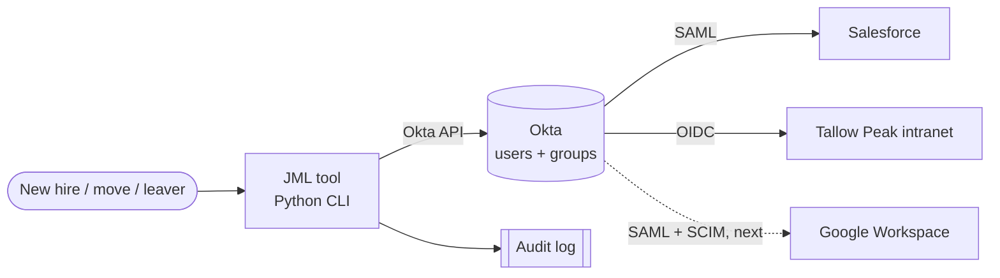

# Phase 1: Identity

**Status: in progress.** Okta is the identity provider for Tallow Peak, a fictional startup.
Staff sign in once at Okta and reach every app from there; a Python tool handles
joiners, movers and leavers; access follows Okta groups.

> Home lab work. Tallow Peak, its people and its domain are fictional.

## What's working

| Area | What's built | Details |
|---|---|---|
| **Okta org** | 5 groups (Engineering, Sales, Ops, Leadership, All-Staff), 9 staff seeded by script, admin MFA with a YubiKey | [seed_users.py](jml-tool/seed_users.py), [screenshots](screenshots/) |
| **JML automation** | Python CLI: `join`, `move`, `leave` with dry runs, safety checks and a JSON-lines audit log | [jml-tool/](jml-tool/) |
| **SAML SSO** | Salesforce Developer Edition signs in through Okta, users matched by Federation ID | [How it works](#saml-sso-to-salesforce) |
| **OIDC SSO** | Tallow Peak intranet (Flask): authorization code + PKCE, group-based access (403), step-up MFA, friendly error pages | [intranet/](intranet/) |
| **Signed commits** | Every commit is signed with an SSH key that lives on a YubiKey | Shows as Verified on GitHub |

## What's next

- [ ] Google Workspace: SAML SSO + SCIM provisioning, so `leave` suspends the Workspace account
- [ ] Group rules: All-Staff gets Google Workspace, Sales gets Salesforce
- [ ] Okta Workflows: an offboarding checklist flow
- [ ] Terraform: Okta groups and group rules as code ([terraform/](terraform/))
- [ ] Write-up: screenshots of each flow and "What I learned"

## How it works

**Groups are the source of truth for access.** The JML tool only changes users and group
memberships. Okta assigns apps by group, and each app decides what a person may do from
the groups Okta vouches for. Moving someone between departments is one command, and their
access follows.

### JML tool

`join` creates the user, adds their department group and All-Staff, and emails a setup link.
`move` removes the old department group before adding the new one, so nobody holds both.
`leave` runs in a fixed order: **end sessions and revoke tokens first** (cuts live access now),
then remove groups (SCIM suspends app accounts), then deactivate. Users are never deleted, so
the history stays for audits. Every step is written to an audit log as it happens.
See [jml-tool/README.md](jml-tool/README.md) and the design in [SPEC.md](jml-tool/SPEC.md).

### SAML SSO to Salesforce

Okta signs an XML assertion (Issuer, Audience, NameID, time window) and the browser posts it
to Salesforce, which checks the signature with Okta's certificate and finds the user whose
Federation ID matches the NameID.

**Debugging note:** the first sign-ins failed with "Unable to load a config from the
assertion's issuer and audience". Okta's preview suggested one Audience, but decoding the
actual SAML response showed Okta sent the org's domain without `.develop` (Developer Edition
orgs live under `.develop.my.salesforce.com`). Setting the Entity ID to exactly that value fixed it.

### OIDC SSO to the intranet

The intranet uses the authorization code flow with PKCE and verifies the ID token before
trusting it. Department pages require membership of that Okta group (403 otherwise), and
payroll requires a two-factor sign-in from the last 5 minutes, sending the person back to
Okta to verify if needed. See [intranet/README.md](intranet/README.md), including why access
decisions use the `acr` claim rather than `amr`.

## Security practices

- Secrets (Okta API token, OIDC client secret) live only in `.env`, which is gitignored
- Admin accounts use phishing-resistant MFA (YubiKey); staff use Okta Verify
- The JML tool refuses to offboard the admin account that runs it, and asks for confirmation before `leave`
- Audit logs hold names and emails, so they stay local and are never committed
- Screenshots are cropped or blurred to remove org URLs, IDs and real names

## Screenshots

See [screenshots/](screenshots/): Okta groups and the seeded staff so far. More are added as each flow is finished.

## What I learned

Written at the end of Phase 1.
<!--
Prompts for this section (not shown on GitHub):
- SAML: why the Audience must equal the Entity ID, and how decoding the assertion found the bug
- OIDC: amr says how you signed in, acr says how strong it was; why the step-up check uses acr
- JML: why leave clears sessions before removing groups
- Groups as the source of truth: how one move changes access everywhere
- Secrets: keeping tokens in .env and out of Git, and what to do if one leaks
-->
